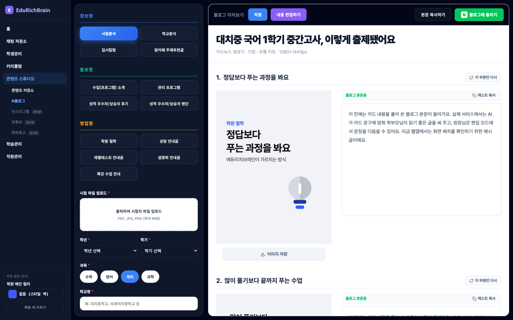
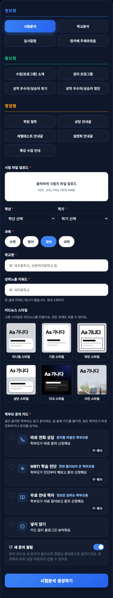
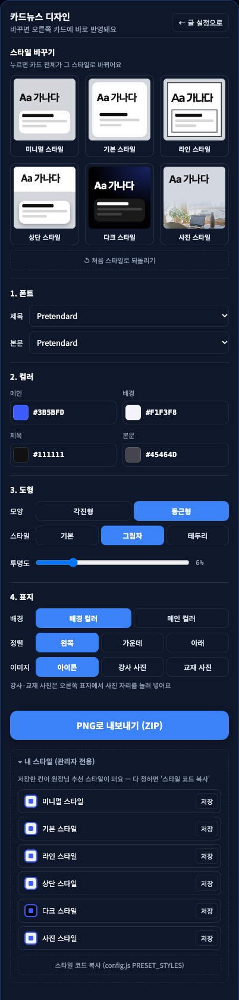
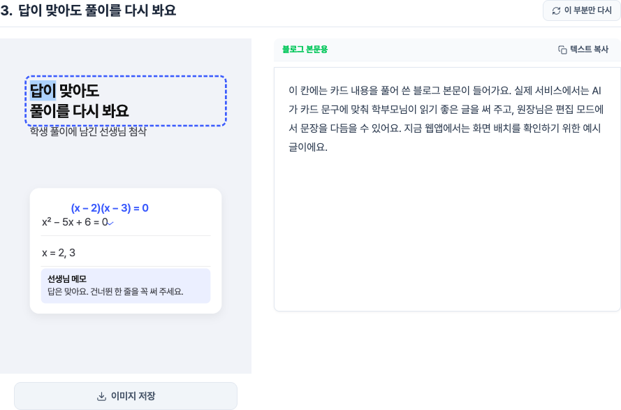

# 카드뉴스 메뉴 구조 — 데브 서버에 옮길 것 (2026-10-17)

데브 서버 콘텐츠 스튜디오(N블로그 → 카드뉴스)의 메뉴를 **이 웹앱의 메뉴 구조**로 바꾼다. 웹앱 화면(`kit/index.html` + `panel/studio.css`)은 구조를 보여 주는 시안이다.

> **구조만 따르고, 디자인은 홈페이지 것으로.** 메뉴의 순서·항목·동작을 맞추고, 색·글꼴·간격·버튼 모양은 홈페이지 디자인 시스템(지금 `KitDesignPanel` 등)을 그대로 쓴다. `studio.css`는 옮기지 않는다.

## 1. 한눈에 — 지금 데브 서버와 다른 곳

데브 서버는 2026-10-17에 본 화면 기준.

| 자리 | 지금 데브 서버 | 바꿀 모양 (웹앱) |
|---|---|---|
| 글 설정의 스타일 고르기 | '내 스타일' 빈 칸 5개(원장님이 저장한 스타일) + '카드뉴스 더 디자인해보기' 버튼 | **'카드뉴스 스타일'** — 추천 스타일 6개를 정사각 견본 카드로 보여 주고 하나를 고른다. 디자인 버튼은 없다 |
| 디자인 패널 여는 법 | '카드뉴스 더 디자인해보기' 버튼(생성 전에도 열림) | **'생성하기'** → 오른쪽에 '만드는 중' 표시 → 다 되면 **디자인 패널이 자동으로 열린다** |
| 디자인 패널 맨 위 | 내 스타일 5칸 + 칸마다 '저장' | **'스타일 바꾸기'** — 추천 스타일 6개 견본 카드(누르면 카드 전체가 그 스타일로) + **'처음 스타일로 되돌리기'** |
| 1. 폰트 | 제목 · 본문 | 같음 (폰트 40종, 메뉴는 가나다 순) |
| 2. 컬러 | 프리셋 칩 4개(블루 · 코랄 · 그린 · 네이비) + 메인 · 배경 · 제목 · 본문 HEX | **프리셋 칩 4개 삭제**, HEX 4칸만. 메인은 처음부터 **학원 메인 컬러** |
| 3. 도형 | 모양 · 스타일 · 투명도 | 같음 (테두리 스타일이면 테두리 굵기 · 색) |
| 4. 카드 배경 | 기본 · 카드형 · 테두리형 · 상단 강조 | **메뉴에서 뺀다** — 추천 스타일이 정한 값을 쓴다(옵션 값은 그대로 저장·적용) |
| 5. 표지 → **4. 표지** | 배경 · 정렬(왼쪽 · 가운데) · 이미지 | 번호가 4로. **정렬에 '아래' 추가**. 사진 스타일이면 표지 옵션 잠금 + 안내 문구 |
| 6. 교재 목업 각도 | 정면 · 책등 · 옆면 · 옆면 넓게 | **패널에서 뺀다** — 카드 위 사진 도구의 '각도' 버튼(누를 때마다 정면 → 책등 → 옆면). '옆면 넓게'는 삭제 |
| 결과 화면 섹션 머리 버튼 | '카드 문구 수정' · '이 부분만 다시' | **'카드 문구 수정' 삭제** — '이 부분만 다시'만 남긴다 |
| 카드 글자 고치기 | '카드 문구 수정' 버튼으로 | **카드 글자를 더블클릭해 그 자리에서 고친다** (글자 위에서 입력 커서) — 아래 ⑤ |
| 내 스타일 (관리자용) | — | 웹앱에만 있는 관리자 도구 — **홈페이지에 넣지 않는다** |

## 2. 따를 구조 (순서대로)

### ① 글 설정 (생성 전)

1. 콘텐츠 타입 (정보형 · 홍보형 · 영업형) — 지금과 같음
2. 타입별 입력 칸 — 지금과 같음
3. **카드뉴스 스타일** ← 새로: 추천 스타일 6개 견본 카드 중 하나 고르기. 안내 문구 "고른 스타일로 카드뉴스를 만들어요. 만든 뒤에도 바꿀 수 있어요."
4. 학부모 문의 카드 · 새 문의 알림 — 지금과 같음
5. **생성하기**

'카드뉴스 더 디자인해보기' 버튼과 '내 스타일' 빈 칸은 없앤다.

### ② 생성 중 → 결과 + 디자인 패널

- 생성하기를 누르면 오른쪽에 '카드뉴스를 만들고 있어요' 표시.
- 끝나면 오른쪽에 결과(카드마다 섹션: 'N. 섹션 제목' + **'이 부분만 다시'**(카드 문구 수정 버튼은 없앰) / 카드 · 이미지 저장 · 블로그 본문), 왼쪽은 **디자인 패널로 자동 전환**.
- 디자인 패널 머리: '카드뉴스 디자인 / 바꾸면 오른쪽 카드에 바로 반영돼요' + '← 글 설정으로'(지금과 같음).

### ③ 디자인 패널

1. **스타일 바꾸기** — 추천 스타일 6개 견본 카드(2줄 × 3칸). 지금 스타일에 테두리 표시. 누르면 카드 전체가 그 스타일로.
2. **처음 스타일로 되돌리기** — '생성하기'를 누를 때 고른 스타일과 옵션으로 돌아간다.
3. **1. 폰트** — 제목 · 본문
4. **2. 컬러** — 메인 · 배경 · 제목 · 본문 HEX (프리셋 칩 없음)
5. **3. 도형** — 모양(각진형 · 둥근형) · 스타일(기본 · 그림자 · 테두리) · 그림자면 투명도 / 테두리면 굵기 · 색
6. **4. 표지** — 배경(배경 컬러 · 메인 컬러) · 정렬(왼쪽 · 가운데 · 아래) · 이미지(아이콘 · 강사 사진 · 교재 사진) + "강사·교재 사진은 오른쪽 표지에서 사진 자리를 눌러 넣어요"

캡처 아래쪽의 'PNG로 내보내기'와 '내 스타일 (관리자 전용)'은 웹앱 전용이다. 홈페이지는 지금처럼 카드마다 '이미지 저장'을 쓰고, '내 스타일'은 넣지 않는다.

### ④ 카드 위 사진 도구 (사진 자리에 마우스를 올리면)

사진 오른쪽 위 아이콘 막대 하나: **사진 변경** · **다른 사진**(같은 주제의 다음 사진, 사진 모음 `pool:` 자리만) · **원본 비율로 / 칸에 맞춰 채우기** · **작게 / 크게**(바꾸면 %) · **이 사진 빼기** · 교재 목업이면 **각도**. 좁은 자리에서는 크기 버튼을 숨긴다. 빈 자리에만 '클릭해서 사진 넣기' 안내.

### ⑤ 카드 글자 바로 고치기 (2026-10-17 추가)

결과 화면의 카드에서 글자를 바로 고친다. '카드 문구 수정' 버튼 대신.

- 카드 안 글자(제목 · 부연설명 · 도식 안 글자) 위에 마우스를 올리면 **입력 커서**(`cursor: text`).
- **더블클릭**하면 그 글자 요소만 편집 상태(메인 컬러 점선 테두리)가 된다.
- **Enter 또는 바깥 클릭 = 저장**, **Shift+Enter = 줄바꿈**(` ` — 제목 2줄 나누기), **Esc = 취소**, 붙여 넣기는 서식 없이 글자만.
- 저장하면 카드를 다시 그린다 — 글자 길이에 맞춰 간격 보정(`fit.js`)이 다시 돌고, 섹션 제목('N. …')도 카드 제목을 따라 바뀐다. 스타일·옵션을 바꿔도 고친 글자는 남는다.
- 편집 대상이 아닌 것: 숫자 설정(`data-*`)으로 자동 생성되는 글자 — 시험 달력 날짜, 타이머 범례, 도장 칸 번호, 원고지 칸 등. 사진 자리 안내 글자도 아니다.
- 홈페이지에서는 고친 카드 HTML을 글과 함께 **저장**해야 한다(웹앱은 저장이 없어서 새로고침하면 처음 덱).

## 3. 바꿔야 할 것 (체크리스트)

- [ ] 글 설정: '내 스타일' 빈 칸 5개 + '카드뉴스 더 디자인해보기' 버튼 → **'카드뉴스 스타일' 견본 카드 6개**
- [ ] 생성하기 → 끝나면 디자인 패널 자동으로 열기
- [ ] 디자인 패널 맨 위: 내 스타일 5칸 → **스타일 바꾸기(견본 6개) + 처음 스타일로 되돌리기**
- [ ] 2. 컬러: 프리셋 칩 4개 삭제
- [ ] 4. 카드 배경 메뉴 숨기기 (값은 추천 스타일 것으로 계속 적용)
- [ ] 표지 번호 5 → 4, 정렬에 '아래', 사진 스타일이면 잠금 + 안내
- [ ] 6. 교재 목업 각도 메뉴 삭제 → 사진 도구의 각도 버튼, '옆면 넓게' 삭제
- [ ] 사진 도구 막대에 '다른 사진' · '원본 비율로/칸에 맞춰 채우기'
- [ ] 결과 화면: '카드 문구 수정' 버튼 삭제
- [ ] 카드 글자 위 입력 커서 + 더블클릭 편집(Enter 저장 · Shift+Enter 줄바꿈 · Esc 취소), 고친 HTML 저장
- [ ] 추천 스타일 칸 5 → 6 (`lib/cardkit/defaultStyles.js` ← 키트 `config.js PRESET_STYLES`)

## 4. 동작 규칙 (구현 참고 — 웹앱 코드 위치)

| 동작 | 규칙 | 웹앱 코드 |
|---|---|---|
| 추천 스타일 적용 | 기본 옵션 위에 그 스타일 값을 덮고, **메인 컬러는 학원 메인 컬러로 덮어쓴다**(밝기 0.8 넘는 학원 색이면 스타일 색 유지) | `panel/panel.js` 스타일 고르기 + `assets/render.js withBrandColor` |
| 처음 스타일로 되돌리기 | 생성하기를 누를 때 옵션을 저장해 두고(snapshot) 그대로 돌려놓는다(restore) | `panel.js api.snapshot / api.restore`, `kit/main.js initStudio` |
| 견본 카드 | 1080×1080 견본에 'Aa 가나다' + 도형 2개(하나는 메인)·카드 배경 판, 사진 스타일은 아래에 덱 표지 사진. 견본에서만 차이를 과장(밝은 배경 조금 짙게 · 그림자 진하게 · 테두리 3배 · 둥근 모서리 크게) | `kit/main.js drawStyleThumbs` |
| 사진 스타일 표지 | 표지 옵션 = 배경 컬러 · 아래 · 아이콘으로 고정, 버튼 잠금 + "사진 스타일은 표지가 고정돼요" | `panel.js` update 안 `lock` |
| 사진 유형 | 교재 목업 · 강사 누끼 · 사진 묶음은 모든 스타일, 사진 강조 · 배경 사진은 사진 스타일에서만 | `kit/main.js stripPhotos · bgPhoto` |
| 다른 사진 | 덱의 `pool:주제` 자리만 — 같은 주제의 다음 사진 | `kit/main.js resolvePools · poolShift` |
| 카드 글자 고치기 | 덱 원본을 처음 불러올 때 글자가 든 요소마다 `data-eid`를 붙이고, 편집이 끝나면 원본의 같은 `data-eid` 요소를 바꾼 뒤 다시 그린다(그래서 다시 그려도 유지) | `kit/main.js tagEditable · initTextEdit`, 커서·테두리는 `panel/app.css` 끝 |

## 5. 넣지 않을 것

- **'내 스타일 (관리자 전용)'** 메뉴와 '스타일 코드 복사' — 관리자가 추천 스타일을 만드는 도구
- **'학원 설정 (데모)'**(웹앱 왼쪽 아래) — 홈페이지는 실제 학원 설정의 메인 컬러를 쓴다
- **'PNG로 내보내기 (ZIP)'** — 홈페이지는 지금처럼 카드별 '이미지 저장'
- `panel/studio.css`의 색·간격·버튼 모양 — 홈페이지 디자인 시스템으로
